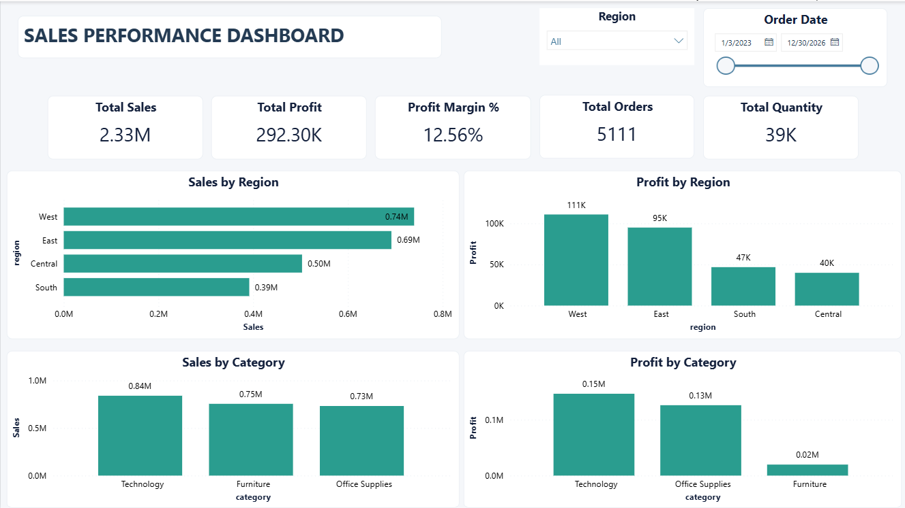
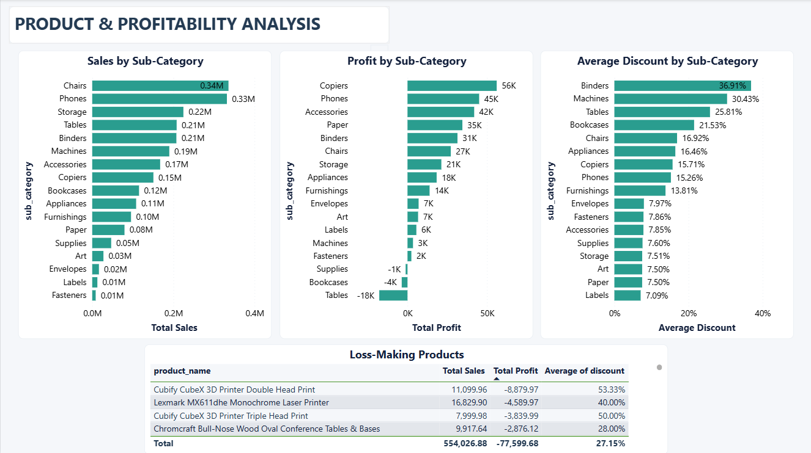
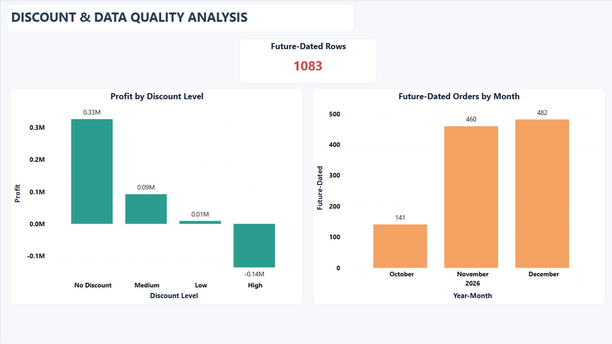

# Sales Performance Analysis
### SQL Data Analysis & Power BI Dashboard Project

## Project Overview

This project analyzes sales performance, profitability, discount strategies, and data quality using SQL and Power BI.

The goal is to identify business trends, investigate loss-making product categories, evaluate the relationship between discounts and profitability, and communicate actionable insights through an interactive dashboard.

## Data Source

This project uses Tableau's Sample Superstore dataset, a fictional retail dataset provided for learning and analysis.

- **Source:** [Tableau Public Sample Data](https://public.tableau.com/app/learn/sample-data)
- **Usage:** Data analysis, SQL practice, and Power BI dashboard development.

## Business Objectives

- Analyze sales and profit across regions and product categories.
- Evaluate profit margins at category and sub-category levels.
- Investigate the relationship between discount levels and profitability.
- Identify loss-making product segments.
- Assess data quality and flag potentially future-dated records.
- Present key findings through Power BI dashboards.

## Tools & Technologies

- **SQL:** Data analysis, aggregation, joins, and transaction-level investigation.
- **Power BI:** Interactive dashboards and business reporting.
- **DAX:** Measures and calculated columns.
- **Data Analysis:** Profitability analysis, discount analysis, and data quality checks.

## Key Performance Indicators

| KPI | Result |
|---|---:|
| Total Sales | 2,326,534.35 |
| Total Profit | 292,296.82 |
| Profit Margin | 12.56% |
| Distinct Orders | 5,111 |

## Key Findings

- **Regional performance:** The West recorded the highest sales and profit among the four regions.
- **Category profitability:** Technology achieved a profit margin of 17.45%, while Furniture recorded a margin of 2.61%.
- **Loss-making sub-categories:** Tables, Bookcases, and Supplies generated negative profits in the analyzed dataset.
- **Discount analysis:** The high-discount group generated a total loss of 136,020.69, highlighting the need to review discount policies.
- **Data quality:** 1,083 records were flagged as future-dated relative to the analysis reference date. These records require validation rather than automatic classification as errors.

## Dashboard Preview

### 1. Sales Overview

### 2. Product and Profitability Analysis

### 3. Discount and Data Quality Analysis

## Project Structure

- `report/` — Final PDF report.
- `sql/` — SQL queries used for the analysis.
- `power-bi/` — Power BI project file (`.pbix`).
- `images/` — Dashboard screenshots.
- `README.md` — Project documentation.
- `data/` — sample_-_superstore.xls.
## Business Recommendations

1. Review discount policies for products and transactions associated with negative profit.
2. Investigate the pricing and cost structure of loss-making sub-categories.
3. Monitor profitability alongside sales volume when evaluating performance.
4. Validate future-dated records before using them for time-based reporting.
5. Use the Power BI dashboards to monitor sales, profit, and margin trends.

## Limitations

The findings are based on the available dataset and its recorded fields. The observed relationship between discounts and profitability does not, by itself, establish causation. Future-dated records were flagged for investigation and should be validated before any corrective action.

## Author

**Khalil Azennoud**

Data Analytics | SQL | Power BI | DAX

